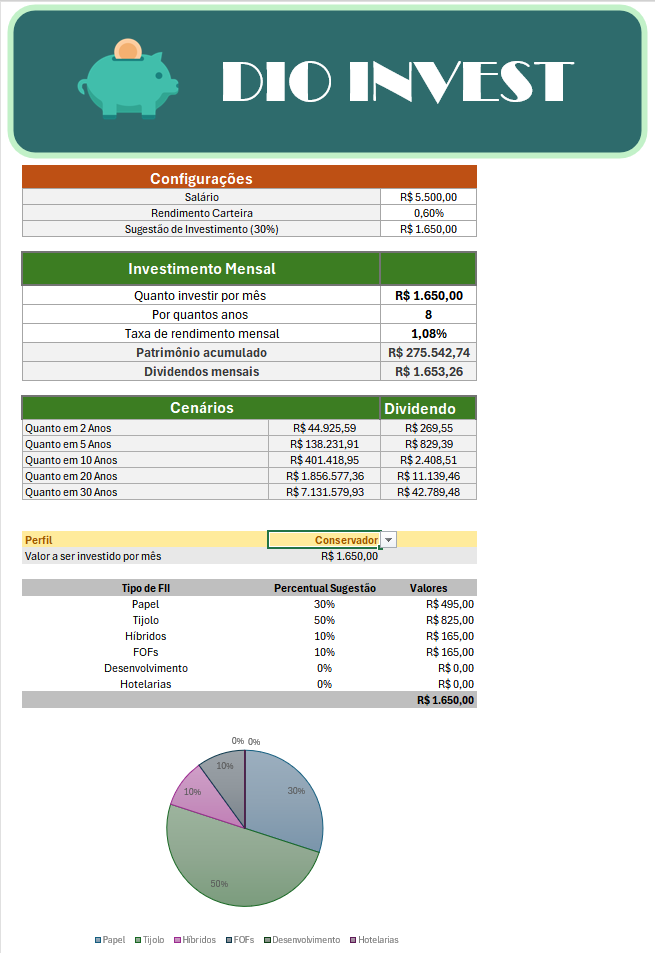
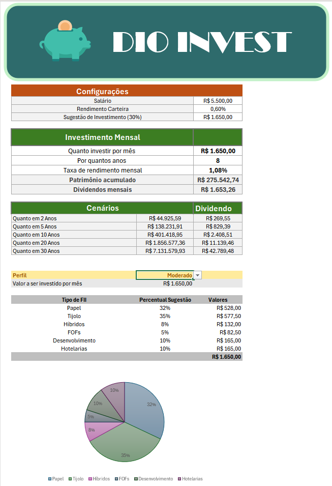
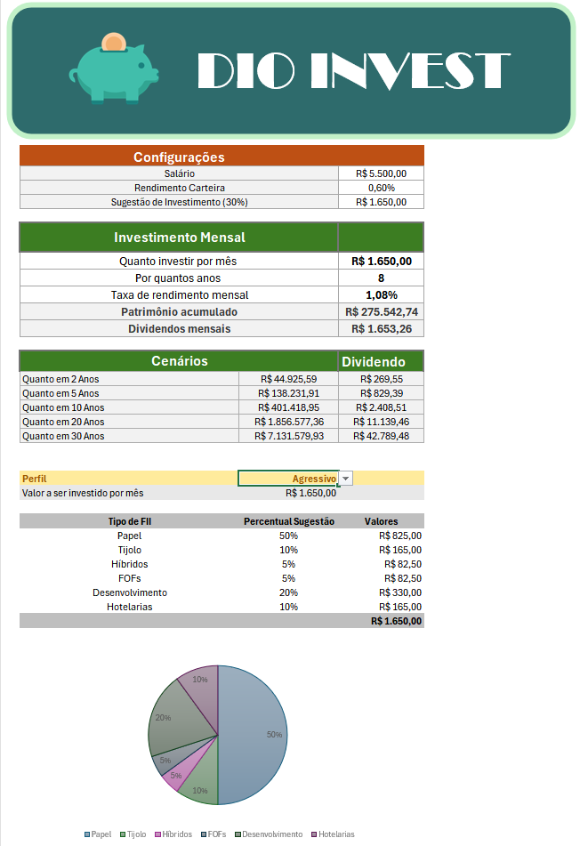

# Ferramenta-de-Controle-de-Investimentos-com-Excel
Ferramenta de controle de investimento criada no Excel como projeto do Bootcamp Reclame AQUI - Dados e IA na Prática da DIO.

## 1. Sobre o Projeto:
Este projeto consiste no desenvolvimento de uma ferramenta em Excel para auxiliar no planejamento de investimentos e na distribuição de aportes de acordo com diferentes perfis de investimento.
A ferramenta permite que o usuário informe seus dados financeiros, selecione um tipo de perfil e visualize como seu dinheiro pode ser distribuído entre diferentes categorias de investimento e saiba a previsão de resultado de seus investimentos ao longo do tempo.

## 2. A planilha foi desenvolvida para responder às seguintes perguntas:
##### Quanto investir por mês? 
##### Por quantos anos? 
##### Qual é a taxa de rendimento mensal?
##### Quanto é o Patrimônio acumulado total?
##### Quanto são os Dividendos mensais?

## 3. Fórmulas utilizadas
##### VF (Valor Futuro):
A função VF é utilizada para calcular o valor futuro de um investimento, considerando os juros, o número de períodos e os aportes realizados, conforme os parâmetros definidos na ferramenta.
##### PROCV:
A função PROCV é utilizada para localizar informações em uma tabela e retornar os dados correspondentes. Na ferramenta, auxilia na busca das informações relacionadas ao perfil selecionado.

## 4. Intervalos nomeados:
Foram criados intervalos nomeados para facilitar a identificação e utilização dos dados nas fórmulas.
##### Aporte: quantia de dinheiro a ser investida por mês. 
##### Dividendos Mensais: valor dos rendimentos mensais
##### Patrimônio acumulado: valor dos rendimentos ao longo dos anos do investimento
##### Valor Investido: Valor a ser investido por mês

## 5. Perfis e percentuais de distribuição - 
A ferramenta contempla os seguintes perfis por tipo de Fundo de Investimento Imobiliário (FII):
##### Conservador: Papel - 30%; Tijolo - 50%; Híbridos - 10%; FOFs - 10%; Desenvolvimento - 0%; Hotelarias - 0%.
##### Moderado: Papel - 32%; Tijolo - 35%; Híbridos - 8%; FOFs - 5%; Desenvolvimento - 10%; Hotelarias - 10%.
##### Agressivo: Papel - 50%; Tijolo - 10%; Híbridos - 5%; FOFs - 5%; Desenvolvimento - 20%; Hotelarias - 10%.
  Os percentuais foram definidos com base em informações em pesquisas de sites como Banco Daycoval e Investidor10.
  Cada perfil possui uma distribuição própria, totalizando 100% do aporte.

## 6. Alterações em relação à ferramenta do Expert:
Em comparação com a ferramenta original do Expert, foram realizadas as seguintes alterações: inserção de demonstração gráfica da distribuição de investimentos, aparência intuitiva e agradável visualmente, 

## 7. Demonstração da ferramenta:
Abaixo estão exemplos da ferramenta preenchida, utilizando a mesma simulação em diferentes perfis de investimento.
### Perfil Conservador
.

### Perfil Moderado
.

### Perfil Agressivo:
.

## 8. Como utilizar:
#### I. Abra a planilha no Excel.
#### II. Preencha os campos solicitados (Salário, Rendimento Carteira, Quanto investir por mês; Por quantos anos).
#### III. Selecione o perfil desejado (Conservador, Moderado ou Agressivo).
#### IV. Consulte os resultados apresentados pela ferramenta.

A planilha foi desenvolvida para facilitar o planejamento financeiro sem exigir conhecimentos avançados de Excel.
